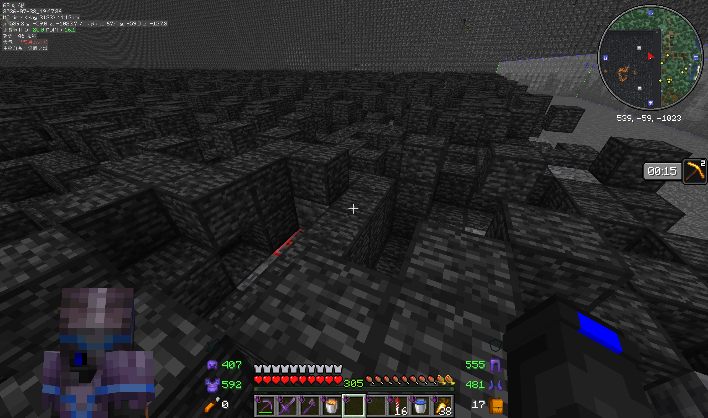
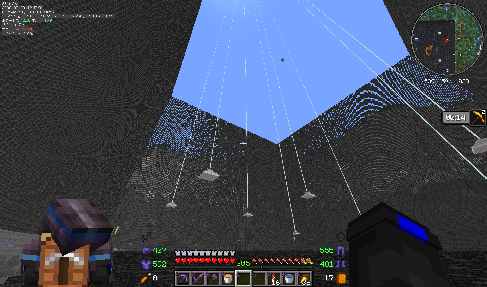
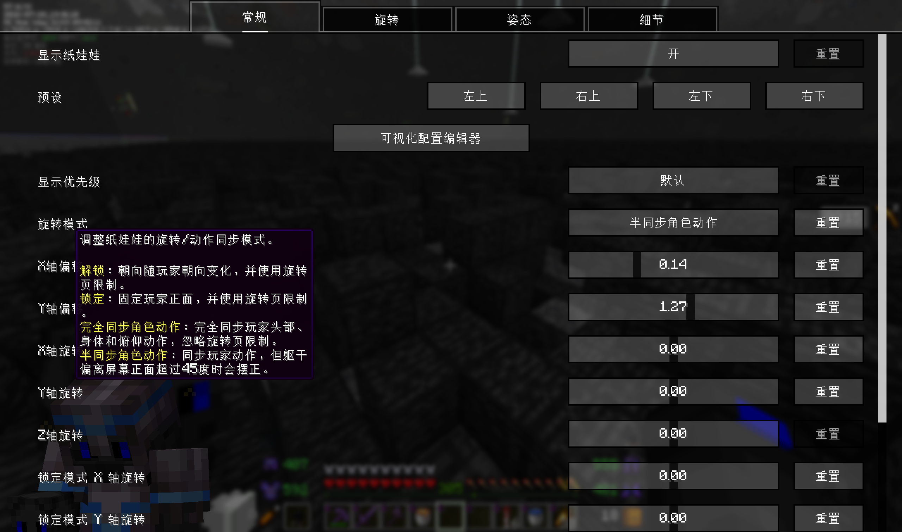
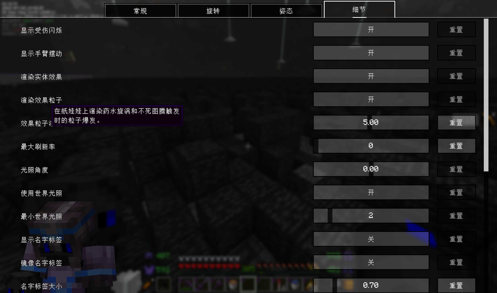

# Ayame PaperDoll:JohnMuyuan Edition

A highly configurable PaperDoll HUD mod for **Minecraft 26.1**, supporting **Fabric** and **NeoForge**. Render your player model in a screen corner with extensive customization and a visual editor.

This edition modifies **Ayame PaperDoll** by HappyRespawnanchor for Minecraft 26.1. Its technical origins trace back to **Extra Player Renderer** by LucunJi. The code is licensed under LGPL-3.0-or-later; see [License](#license).

> [!NOTE]
> This mod shares the internal Mod ID `ayame_paperdoll` with upstream Ayame PaperDoll. **Do not install both together.** Their configuration files are compatible, allowing direct replacement.

## Features

- Render in any corner or at a custom offset, with one-click corner presets.
- Configuration through Mod Menu, the NeoForge mod list, or a keybind.
- Visibility toggle, default **F8**.
- Visual editor: drag to position, right-drag to rotate, scroll to resize.
- Unlock, Lock, full player-motion synchronization, and partial synchronization rotation modes.
- Nameplate rendering with independent mirroring, scale, and offsets.
- Y-axis compensation for sneaking, swimming, crawling, and elytra flight.
- World-light shading, damage flash, arm swinging, and potion/totem particles.
- Render frame-rate limit to reduce overhead.

## Differences from upstream Ayame PaperDoll

Based on comparison with upstream's `26.1` branch.

### Added

| Feature | Details |
| --- | --- |
| Display priority | Default HUD layer, High above chat/subtitles and other HUD elements, or Highest above most screens except the Escape pause menu |
| Rotation modes | FULL_SYNC follows real head/body/pitch motion without rotation limits; HALF_SYNC follows motion but recenters body deviation beyond about 45° |
| Independent Lock rotation | Separate X/Y/Z parameters, adjustable by right-dragging in the editor |
| Nameplates | Player names and scoreboard labels, independent mirroring for readable text, scale (0 hides), and XY offsets |
| Entity effects | Optional fire, invisibility, damage overlays, and increased brightness while burning |
| Effect particles | Custom potion swirls and totem bursts with configurable density, up to 256 |
| Refresh-rate limit | 0–240, default 60; 0 is unlimited. Reuses the previous offscreen texture between updates |
| Configuration migration | Migrates nine historical boolean keys, including `full_sync_motion`, to the new rotation-mode enum |

### Changed

- Offscreen textures are allocated to the actual model bounds, expanding for flight or nameplates, rather than the full screen, reducing memory use.
- Mirroring is passed through render state. Readable mirrored nameplates use separate model and nameplate passes.
- Fire visibility follows the entity-effects toggle instead of clearing fire ticks. Outline glow is disabled because it produces a white silhouette in picture-in-picture rendering; invisible entities render translucently.
- Spectator mode uses the local player directly when the player name is empty.
- Editor controls add Shift+left-drag for nameplate offset, right-drag for X/Y rotation, and Ctrl+right-drag for Z rotation.
- Unknown configuration categories, options, and enum values are skipped while preserving defaults.
- Simplified and Traditional Chinese translations have consistent wording and punctuation.

### Removed

- Vehicle rendering (`render_vehicle`) and its configuration, which was incomplete upstream.
- The special 180° boat rotation correction.
- The NeoForge `updateJSONURL` automatic update check pointing to the upstream Modrinth project.

## Screenshots






## Installation

Download the JAR for your loader from [Releases](https://github.com/JohnMuyuan/Ayame-PaperDoll/releases/latest) and place it in `mods`.

- **Minecraft:** 26.1
- **Fabric:** Fabric Loader ≥ 0.18.5 and Fabric API ≥ 0.144.3+26.1; Mod Menu is optional for accessing settings.
- **NeoForge:** ≥ 26.1.0.7-beta

## Build

Requires **JDK 25**:

```bash
./gradlew build
```

Outputs are in `fabric/build/libs/` and `neoforge/build/libs/`.

## Versioning

Versions use `x.y.z+26.1`, independently starting at `1.0.0`. See [CHANGELOG.md](CHANGELOG.md).

## Credits

- **LucunJi:** original author of [Extra Player Renderer](https://modrinth.com/mod/extraplayerrenderer).
- **HappyRespawnanchor:** author of [Ayame PaperDoll](https://github.com/AyameMC/Ayame-PaperDoll), whose 26.1 branch is this edition's starting point.
- Fallen_Breath, X-Green, altrisi, plusls, pertaz, LightgraycaAT: upstream contributors.
- **JohnMuyuan:** maintenance and development of this edition.

## License

**LGPL-3.0-or-later**, matching upstream. Upstream copyrights belong to LucunJi, HappyRespawnanchor, and contributors; modifications and additions in this edition belong to JohnMuyuan. See [LICENSE](LICENSE), [COPYING](COPYING), [COPYING.LESSER](COPYING.LESSER), and [licenses/](licenses).
